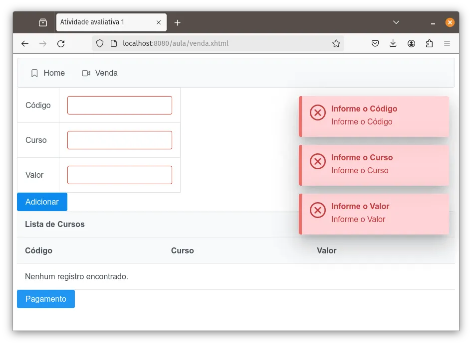
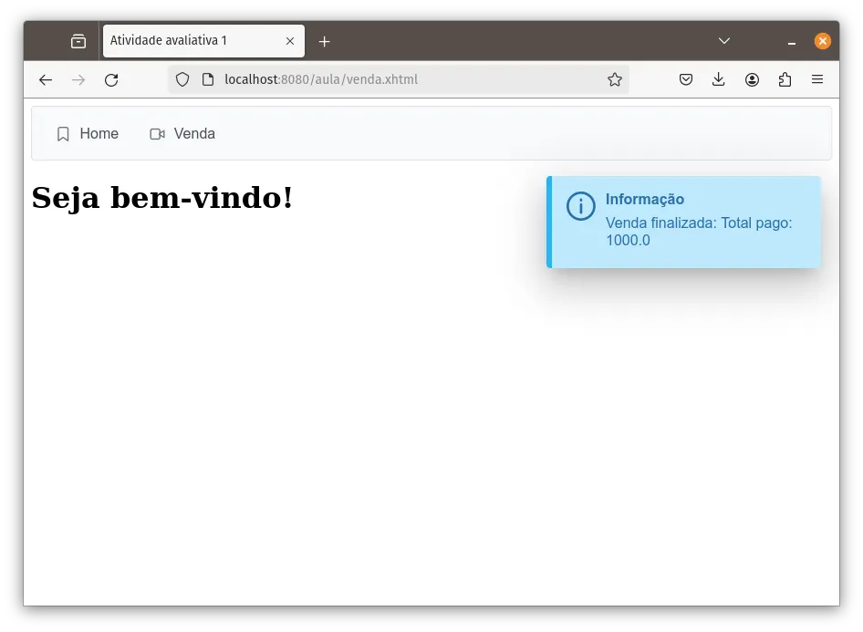

# 🎓 Sistema de Venda de Cursos (JSF + PrimeFaces + JPA)


Aplicação web em **Java (Jakarta Faces / JSF, PrimeFaces, CDI, EJB e JPA)** desenvolvida para a disciplina de **Ferramentas de Programação** no IFSP Campus Presidente Epitácio. O sistema simula o fluxo completo de venda de cursos, desde a inclusão e validação de itens até o cálculo de desconto em tempo real e a persistência da venda no banco de dados.

---

## 📸 Capturas de Tela

| Página Inicial | Tela de Venda |
| :---: | :---: |
|  |  |

| Validação de Campos Obrigatórios | Validação de Código e Valor (> 0) |
| :---: | :---: |
|  |  |

| Curso Adicionado com Sucesso | Validação de Lista Mínima |
| :---: | :---: |
|  |  |

| Seleção de Desconto no Pagamento | Venda Finalizada na Home |
| :---: | :---: |
|  |  |

---

## ⚙️ Funcionalidades Implementadas

### 🧭 Menu e Notificações (`WEB-INF/template.xhtml`)
- Barra de navegação com ícones personalizados para os itens **Home** (`/index.xhtml`) e **Venda** (`/venda/criar.xhtml`).
- Exibição de mensagens de erro, atenção e sucesso em formato de balão por meio do componente `<p:growl>`.

### 🛒 Página de Venda (`venda/criar.xhtml`)
- Campos obrigatórios de **Código**, **Curso** e **Valor**, com foco automático ao clicar nos respectivos rótulos (`<p:outputLabel for="..." />`).
- Validação garantindo que **Código** e **Valor** sejam maiores que zero.
- Adição dinâmica de cursos na tabela **Lista de Cursos**.
- Botão **Pagamento** configurado com `immediate="true"`, permitindo o avanço apenas quando há pelo menos um curso adicionado na lista.

### 💳 Página de Pagamento (`venda/pagamento.xhtml`)
- Resumo dos cursos selecionados na etapa anterior.
- Seleção de desconto (**5%**, **10%** ou **15%**) com recálculo automático do valor total via `<p:ajax event="change" />`.
- Botão **Finalizar**, que persiste a venda no banco via `VendaDAO`, limpa o estado da sessão para uma nova compra e redireciona para a página inicial exibindo a mensagem com o valor total pago.

---

## 📁 Estrutura do Projeto

```text
course-selling-page-with-user-login/
├── src/
│   ├── conf/
│   │   └── persistence.xml              # Configuração JPA (conexaoPU)
│   └── java/br/edu/ifsp/pep/
│       ├── controller/
│       │   ├── CursoController.java
│       │   └── VendaController.java     # Fluxo de adição, desconto e finalização
│       ├── converter/
│       │   └── CursoConverter.java
│       ├── dao/
│       │   ├── CursoDAO.java
│       │   └── VendaDAO.java
│       └── entidade/
│           ├── Curso.java
│           ├── ItemVenda.java
│           ├── ItemVendaPK.java
│           └── Venda.java
├── web/
│   ├── index.xhtml                      # Página inicial
│   ├── venda/
│   │   ├── criar.xhtml                  # Inclusão de cursos na venda
│   │   └── pagamento.xhtml              # Aplicação de desconto e fechamento
│   └── WEB-INF/
│       ├── template.xhtml               # Layout base com menu e growl
│       └── glassfish-resources.xml      # Fonte de dados MySQL (java:app/jdbc/db_jpa)
└── images-from-project/                 # Capturas de tela das telas e validações
```

---

## 🚀 Como Executar

1. Clone o repositório:
   ```bash
   git clone https://github.com/rtobias-git/course-selling-page-with-user-login.git
   ```
2. Configure o banco de dados **MySQL** e ajuste o arquivo `web/WEB-INF/glassfish-resources.xml`, se necessário.
3. Abra o projeto no **Apache NetBeans** com o **GlassFish Server** configurado e execute o deploy da aplicação.

---

## 👤 Autor

Desenvolvido por **Tobias Rafael** ([@rtobias-git](https://github.com/rtobias-git)) — IFSP Campus Presidente Epitácio.
