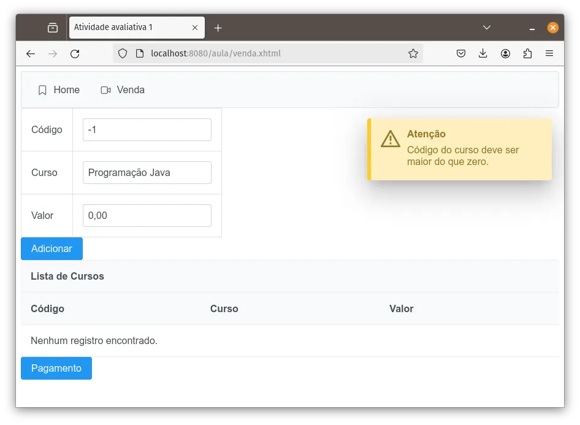
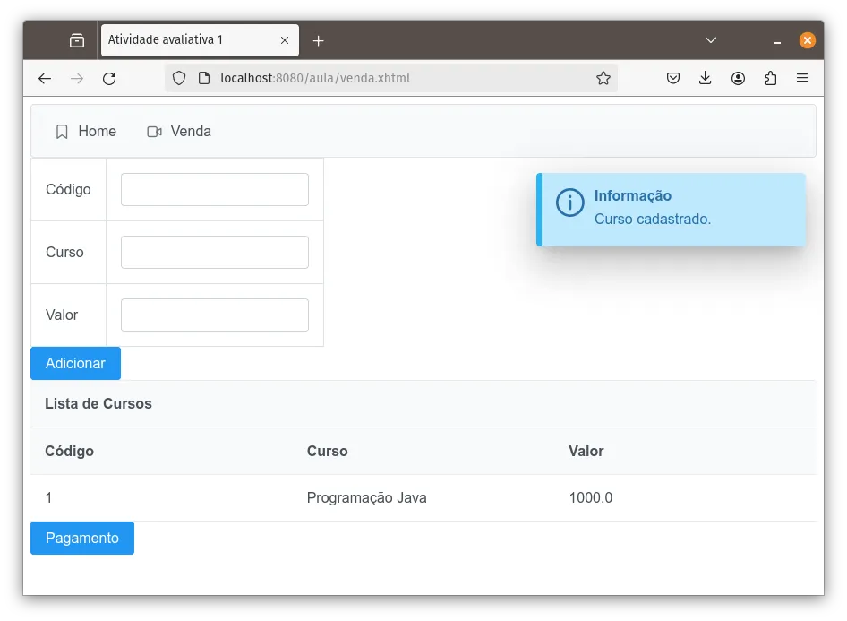
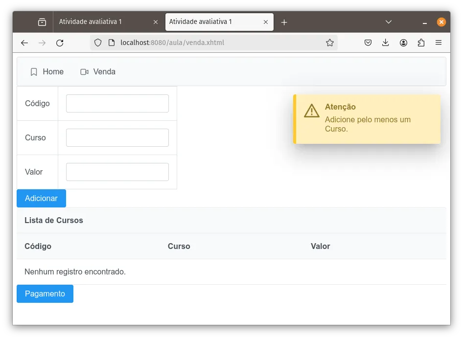
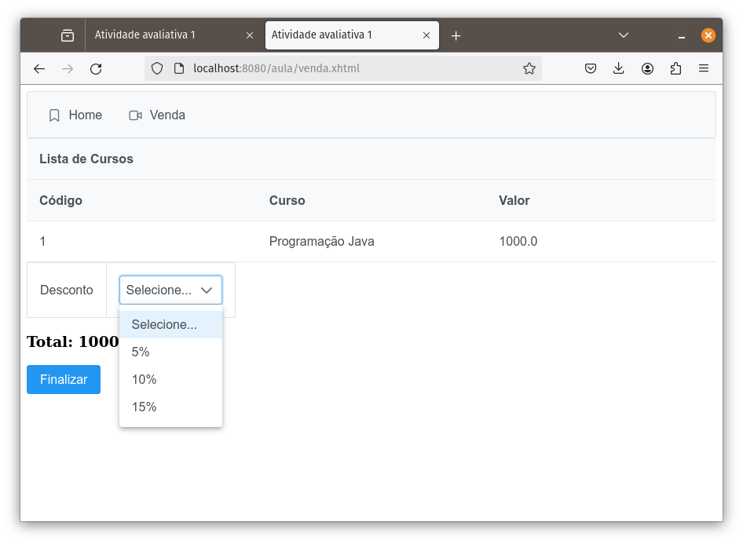

# Sistema de Venda de Cursos (JSF + PrimeFaces + JPA)


Aplicação web desenvolvida em Java com Jakarta EE (JSF, PrimeFaces, CDI, EJB e JPA) para a disciplina de Ferramentas de Programação no IFSP (Campus Presidente Epitácio). O sistema simula o fluxo de venda de cursos, cobrindo validação de formulários, aplicação de descontos em tempo real com AJAX e gravação da compra no banco de dados.

---

## Capturas de tela

| Página Inicial | Tela de Venda |
| :---: | :---: |
|  |  |

| Validação de Campos Obrigatórios | Validação de Código e Valor (> 0) |
| :---: | :---: |
|  |  |

| Curso Adicionado com Sucesso | Validação de Lista Mínima |
| :---: | :---: |
|  |  |

| Seleção de Desconto no Pagamento | Venda Finalizada na Home |
| :---: | :---: |
|  |  |

---

## Funcionalidades

### Navegação e mensagens (template.xhtml)
- Menu de navegação para a página inicial e tela de vendas.
- Exibição de avisos e mensagens de validação usando o componente p:growl.

### Inclusão de cursos (venda/criar.xhtml)
- Campos para informar código, curso e valor.
- Validação garantindo que código e valor sejam maiores que zero.
- Adição dos cursos selecionados em uma tabela antes de avançar para o pagamento.

### Pagamento e desconto (venda/pagamento.xhtml)
- Resumo dos cursos adicionados ao pedido.
- Opções de desconto (5%, 10% ou 15%) com recálculo do valor total via AJAX.
- Finalização da compra, registro da venda no banco de dados via JPA e redirecionamento com confirmação do valor pago.

---

## Estrutura do projeto

```text
course-selling-page-with-user-login/
├── src/
│   ├── conf/
│   │   └── persistence.xml              # Configuração JPA (conexaoPU)
│   └── java/br/edu/ifsp/pep/
│       ├── controller/
│       │   ├── CursoController.java
│       │   └── VendaController.java     # Fluxo de adição, desconto e finalização
│       ├── converter/
│       │   └── CursoConverter.java
│       ├── dao/
│       │   ├── CursoDAO.java
│       │   └── VendaDAO.java
│       └── entidade/
│           ├── Curso.java
│           ├── ItemVenda.java
│           ├── ItemVendaPK.java
│           └── Venda.java
├── web/
│   ├── index.xhtml                      # Página inicial
│   ├── venda/
│   │   ├── criar.xhtml                  # Inclusão de cursos na venda
│   │   └── pagamento.xhtml              # Aplicação de desconto e fechamento
│   └── WEB-INF/
│       ├── template.xhtml               # Layout base com menu e growl
│       └── glassfish-resources.xml      # Fonte de dados MySQL (java:app/jdbc/db_jpa)
└── images-from-project/                 # Capturas de tela das telas e validações
```

---

## Como executar

1. Clone o repositório:
   ```bash
   git clone https://github.com/rtobias-git/course-selling-page-with-user-login.git
   ```
2. Configure o banco de dados MySQL e ajuste o arquivo `web/WEB-INF/glassfish-resources.xml` se necessário.
3. Abra o projeto no NetBeans e faça o deploy no GlassFish Server.

---

## Autor

Desenvolvido por **Tobias Rafael** ([@rtobias-git](https://github.com/rtobias-git)), estudante do IFSP Campus Presidente Epitácio.
